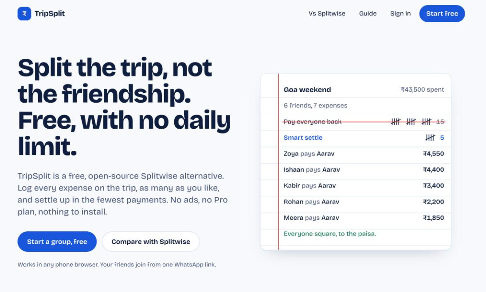
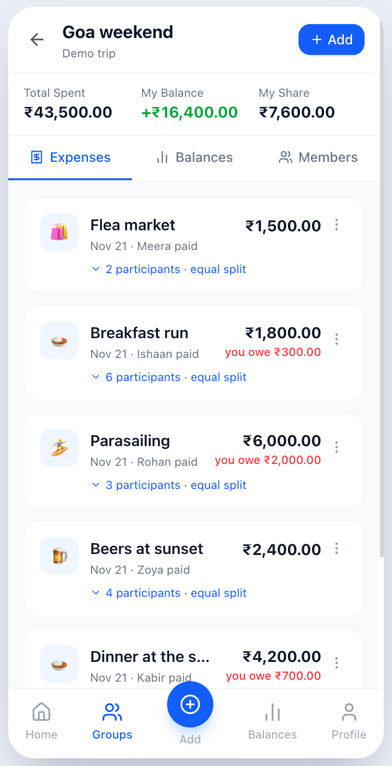
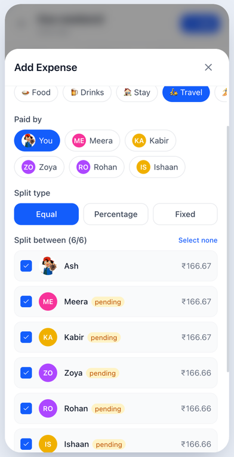
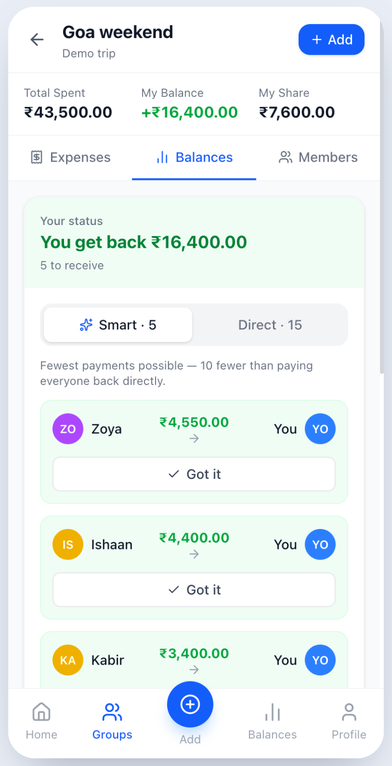

<div align="center">

# TripSplit

**Split the trip, not the friendship.**
The free, open-source Splitwise alternative: no daily expense limit, no ads, no Pro plan.

[**Try it →**](https://gotripsplit.app) &nbsp;·&nbsp; [Why not Splitwise?](https://gotripsplit.app/splitwise-alternative) &nbsp;·&nbsp; [Self-host](#self-host-in-10-minutes)

[](LICENSE)
[](src/lib/utils/balance.test.ts)
[](https://nextjs.org)
[](https://workers.cloudflare.com)



</div>

---

## Why

Splitwise's free plan now caps how many expenses you can add per day and shows ads between entries. That's fine for a flat. It breaks on a trip, where ten friends log twenty expenses before lunch.

TripSplit does the job for free, for good: open source, no premium tier, nothing held back.

<table>
<tr>
<td align="center"><br><sub>Log everything, no daily cap</sub></td>
<td align="center"><br><sub>Equal, % or exact splits, to the paisa</sub></td>
<td align="center"><br><sub>15 payments → 5 with smart settle</sub></td>
</tr>
</table>

## Features

- **Unlimited expenses.** No counters, no timers, no ads.
- **Smart settle-up.** The fewest payments that clear every balance (exact for groups of up to 14 people with a balance), or switch to "Direct" to pay back exactly who paid for you.
- **Splits that always add up.** Equal, percentage or exact amounts. A split that's off by even 1 paisa can't be saved, and the database enforces it too.
- **Friends join from one link.** Add people by name, start logging, then drop one link in WhatsApp. Each person taps their name and inherits everything already logged for them.
- **Itemized bills.** Enter what each person ordered; tax, service and tip are spread in proportion.
- **Trip stats.** Where the money went, spend by day, who paid upfront, and fun awards (Chief Beer Officer, anyone?).
- **Search and filters** by text, category or payer, plus **CSV export** for spreadsheets.
- **Receipt photos** on any expense, compressed on your phone and visible only to the group.
- **Any currency symbol** per trip (₹, ฿, €, $…). No conversion, just the right symbol.
- **Admins and an activity log.** Admins control settings and can promote others; every add, edit and delete is logged.
- **One-tap UPI.** "Pay via UPI" opens GPay / PhonePe / Paytm with the amount filled in. TripSplit never touches money.
- **No install.** Mobile-first web app, add it to your home screen.
- **Private by default.** Row-level security means only group members can read a group.

## The maths

The maths is the whole point, so it's isolated in one module ([`src/lib/utils/balance.ts`](src/lib/utils/balance.ts)) and tested hard.

- **Integer paise everywhere.** No floating-point drift, ever.
- **Equal splits** hand leftover paise out one at a time, so ₹100 ÷ 3 = 33.34 + 33.33 + 33.33.
- **Percentage splits** use largest-remainder rounding, so they always sum to the total exactly.
- **Smart settle** finds the true minimum number of payments. Minimum = (people with a balance) − (the most groups whose balances already cancel out). We solve that partition exactly with a bitmask search for up to 14 people with non-zero balances, then fall back to greedy matching.
- **Atomic saves.** An expense and its split are written in one database transaction ([`save_expense`](supabase/atomic_expenses.sql)), which rejects any split that doesn't match the amount.

```bash
npm test   # 50 tests, thousands of randomised cases
```

The tests check that splits always sum to the total, that balances always sum to zero, that the smart plan clears everyone to the paisa, and that it matches an independent brute-force minimum. Cloudflare runs them before every deploy, so broken maths can't ship.

## Tech

| | |
|---|---|
| App | Next.js 16 (App Router), React 19, TypeScript, Tailwind CSS 4 |
| Data and auth | Supabase (Postgres, row-level security, Google / email auth) |
| Hosting | Cloudflare Workers via [OpenNext](https://opennext.js.org/cloudflare) |
| Tests | Vitest |

## Self-host in 10 minutes

**1. Supabase:** create a free project, then run these in the SQL editor, in order:

```
supabase/schema.sql
supabase/fix_rls_recursion.sql
supabase/add_pending_members.sql
supabase/goa_upgrade.sql
supabase/one_link_invites.sql
supabase/atomic_expenses.sql
supabase/trust_and_admin.sql
supabase/stats_items_receipts.sql
supabase/pay_methods.sql
supabase/group_types.sql
supabase/archive.sql
supabase/multi_currency.sql
supabase/admin_tools.sql
supabase/balance_links.sql
supabase/feedback.sql
supabase/paid_back.sql
```

Under **Authentication → URL Configuration**, set your site URL and add `https://YOUR-DOMAIN/api/auth/callback**` as a redirect URL. Enable Google under **Providers** if you want one-tap sign-in.

**2. Run locally**

```bash
git clone https://github.com/ashvinpanicker/trip-split && cd trip-split
cp .env.example .env.local     # add your Supabase URL + anon key
npm install
npm run dev                    # http://localhost:3000
```

**3. Deploy to Cloudflare** (free tier is plenty)

- Dashboard → **Workers & Pages → Create → Import a repository**
- Build command: `npm test && npx opennextjs-cloudflare build`
- Deploy command: `npx opennextjs-cloudflare deploy`
- Build variables: `NEXT_PUBLIC_SUPABASE_URL`, `NEXT_PUBLIC_SUPABASE_ANON_KEY`, and optionally `NEXT_PUBLIC_SITE_URL` (your public URL, used for SEO canonicals), `NEXT_PUBLIC_GOOGLE_CLIENT_ID` (keeps Google sign-in on your own domain), `NEXT_PUBLIC_GA_ID` and `NEXT_PUBLIC_CONTACT_EMAIL`

Or from your machine: `npx wrangler login && npm run deploy`.

## Project structure

```
src/
  app/(marketing)/      public SEO pages: landing, /splitwise-alternative, /how-to-split-trip-expenses
  app/(app)/            the app: dashboard, groups, balances, profile
  app/join/[code]/      invite links ("Which one are you?")
  lib/utils/balance.ts  all money maths  ← start here
  lib/utils/balance.test.ts
supabase/               schema + migrations (run in order above)
```

The public site ships `sitemap.xml`, `robots.txt` (private routes excluded), [`llms.txt`](https://gotripsplit.app/llms.txt) for AI assistants, and schema.org data (WebApplication, FAQPage, HowTo, Article).

## Roadmap

- [ ] Multiple currencies on one trip
- [ ] Import from Splitwise CSV
- [ ] Receipt photos
- [ ] Offline mode

Ideas and PRs welcome. Open an issue first for anything big.

## Contributing

1. Fork, branch, `npm install`
2. Keep money logic in `balance.ts`, with tests
3. `npm test && npx tsc --noEmit` before opening a PR

## License

[MIT](LICENSE) © 2026 Ashvin Panicker. Use it, fork it, self-host it.

<sub>Splitwise is a trademark of Splitwise, Inc. TripSplit is an independent open-source project and is not affiliated with Splitwise.</sub>
